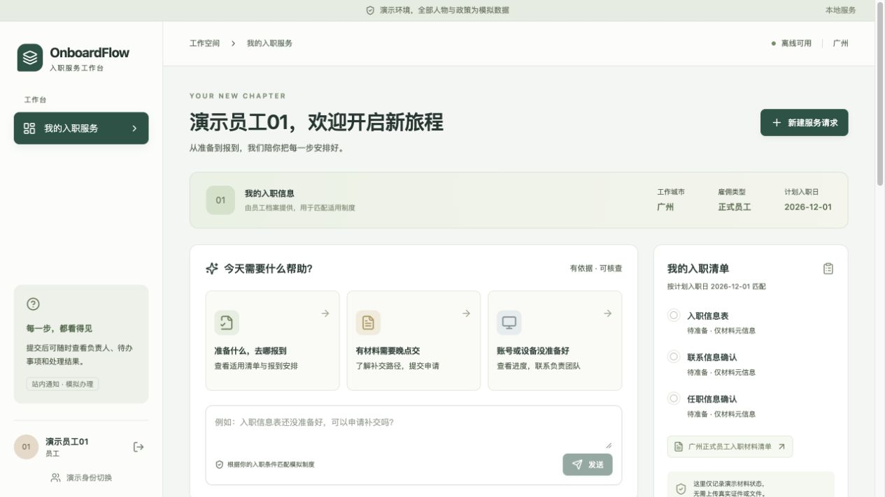
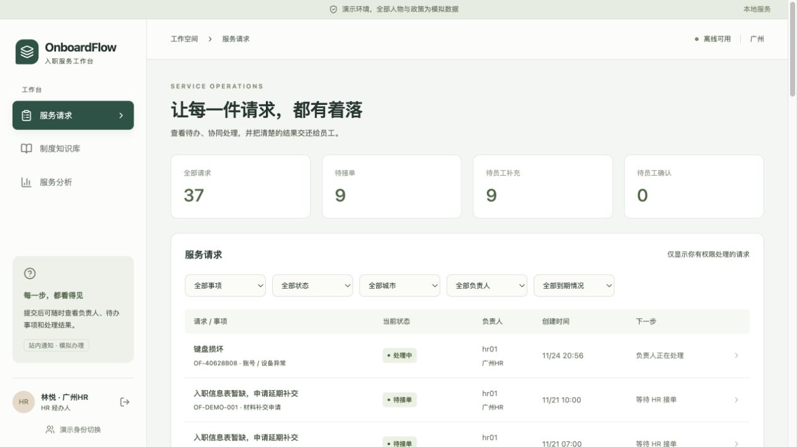
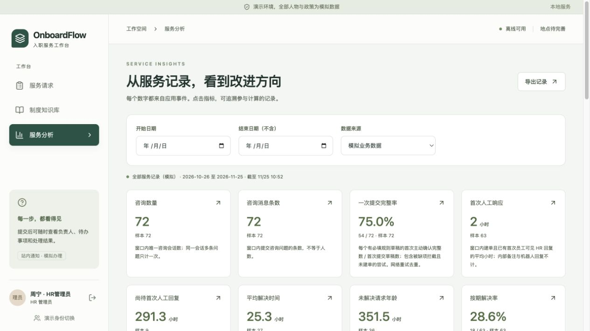

# OnboardFlow · 入职服务工作台

**把入职咨询、HR 处理和 IT 协同串成一条员工能随时查看进度的服务流程。**

员工不必反复问“找谁办、到哪一步了”，HR 可以在同一张请求里补问、分派任务、交付结果，管理员也能从服务记录中找到需要改进的环节。

## 解决什么问题

| 角色 | 遇到的问题 | 工作台提供的办法 |
| --- | --- | --- |
| 员工 | 制度看不懂，材料是否能补交不明确，提交后不知道谁在处理 | 按城市、雇佣类型和入职日期查适用制度；提交前预览；随时查看负责人、进度与下一步 |
| HR | 咨询信息不全，需要来回追问；消息和处理记录分散 | 在请求内补问、公开回复和保存内部备注，按事项判断是否具备办结条件 |
| IT | 只收到“帮忙开账号”，准备要求和前置任务不清楚 | 接收 HR 填写的具体任务说明，按依赖顺序处理本人任务，由 HR 汇总交付 |
| 服务运营 | 看得到工单数，却说不清哪里卡住、指标怎么算 | 查看响应、解决、首次提交完整率和评价，打开参与计算的记录逐项核对 |

## 四个具体优势

1. **答案有适用条件，也有出处。** 先核对城市、雇佣类型和计划入职日，再检索制度；缺条件会澄清，引用可以打开原文。新制度发布后，旧请求仍保留办理时的版本。
2. **流程按实际事项推进。** 材料延期获批，材料状态仍然是“待补交”；账号设备必须完成必要 IT 任务；员工可以确认结果，也可以说明原因申请重开。
3. **协作有主负责人，也有权限边界。** HR 始终负责主请求，IT 只看到分给自己的任务及所需信息。员工、城市 HR、IT 和管理员的权限由后端校验。
4. **指标能回到原始记录。** 首次缺项被拦截也进入完整率分母；网络重试不重复建单；取消、重开和负面评价分别留存，避免把数字算得好看却失去解释能力。

## 一条完整的服务故事

以“入职信息表暂时交不齐”为例：

1. 员工先查询补交规则，查看适用制度和所需信息。
2. 填写缺失材料、预计补交日期和说明，预览后确认提交。
3. HR 接单；信息不足时请员工补充，处理进度和回复都留在原请求里。
4. HR 批准延期并说明约定。申请进入待确认，材料仍显示未补交。
5. 员工查看结果、确认申请；实际补交后，再更新材料状态和跟进任务。
6. 管理员从分析页查看缺项、响应和反馈明细，定位流程中的问题。

如果事项是账号或电脑准备，第 4 步会由 HR 分派 IT 任务，必要任务完成后再交员工确认。更多场景见 [五分钟演示脚本](docs/demo_script.md)。

## 界面预览

员工入口：从查询适用制度，到提交请求和查看下一步。



HR 工作台：集中处理请求、补问信息并安排协同任务。



服务分析：查看指标定义，并追溯参与计算的记录。



## 已经怎样验证

以下为 2026-11-24 的实际执行结果，原始日志与报告均保留在仓库中。

| 检查 | 实际结果 | 主要覆盖 | 证据 |
| --- | ---: | --- | --- |
| 后端回归 | **159 / 159 通过** | 权限、状态流转、制度范围与日期、幂等和指标计算 | [执行日志](reports/roleplay_20261124/backend-regression.txt) |
| 浏览器回归 | **17 / 17 通过** | 页面交互、办理流程与界面回归 | [执行日志](reports/roleplay_20261124/browser-regression-final.txt) |
| 角色拟真演练 | **7 / 7 通过** | 员工、两地 HR、两名 IT、管理员独立会话交接 | [逐场景报告](reports/roleplay_20261124/README.md) |
| 公开合成验收 | **60 / 60 通过** | 回答、澄清、转人工、流程和边界规则 | [验收报告](reports/qa_20261124/evaluation.md) |

角色演练实际发现并修复了 4 个问题：催问误改状态、普通事项误用材料审批结论、IT 缺少具体任务说明、制度原文弹窗被遮挡。7 条故事经修复后完整重跑通过。合成验收检查的是预设规则，不等同于真实用户满意度或完整语义准确率。

## 本地运行

技术栈：**React + TypeScript + Vite · FastAPI + Pydantic · SQLite · Pytest + Playwright**。默认离线模式，无需 API Key。

在仓库根目录执行（macOS / Linux）：

```bash
python3 -m venv .venv
.venv/bin/python -m pip install -r backend/requirements.lock
npm --prefix frontend ci
npm --prefix frontend run build
cp .env.example .env
.venv/bin/python scripts/init_db.py
.venv/bin/python scripts/run.py
```

打开 [本地工作台](http://127.0.0.1:8000)，选择演示身份即可进入。

| 想体验的角色 | 演示账号 |
| --- | --- |
| 员工 | `emp01`（广州正式员工）、`emp02`（深圳正式员工）、`emp07`（演示缺条件澄清） |
| HR | `hr01`（广州）、`hr02`（深圳） |
| IT | `it01`、`it02`，各自查看分配的任务 |
| 管理员 | `admin01`，审核制度、查看服务分析 |

完整账号、开发模式、Windows 命令、环境配置、数据重置和测试复现见 [启动与配置](docs/setup.md)。

## 项目资料

| 想了解什么 | 文档 |
| --- | --- |
| 产品目标、范围与设计思路 | [产品说明](docs/PRD.md) · [项目案例](docs/case_study.md) |
| 如何演示完整流程 | [五分钟演示脚本](docs/demo_script.md) |
| 角色如何协作、状态如何变化 | [权限与流程](docs/permissions.md) |
| 制度如何匹配、引用和更新 | [制度检索与版本](docs/retrieval.md) |
| 数据和指标如何定义 | [数据字典](docs/data_dictionary.md) · [指标口径](docs/metrics.md) |
| 技术选择与测试证据 | [技术决策](docs/decisions.md) · [专业测试](reports/qa_20261124/README.md) · [角色测试](reports/roleplay_20261124/README.md) |
| 后续如何观察真实使用体验 | [用户测试设计](docs/user_research.md) |

开发过程使用 **Codex 辅助编码与测试**，并保留产品说明、技术决策、失败记录和修复后的验证结果。

## 当前范围与下一步

当前是使用模拟人物、制度和历史记录的本地演示原型，支持完整办理和统计闭环；企业登录、真实 HR 系统、材料核验和 IT 开通尚未接入。下一步优先完善档案纠错入口、IT 待办筛选与指标明细中文展示，再通过真人任务测试验证这些流程是否容易理解和完成。
