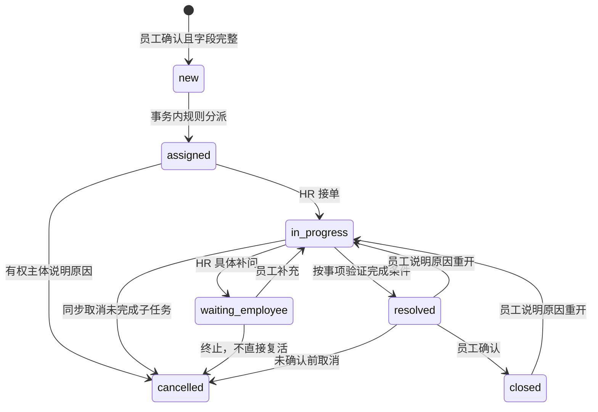

# 权限与流程

|对象/动作|员工|HR 经办人|HR 管理员|IT 经办人|
|---|---|---|---|---|
|员工资料|本人|本组办理必要信息|模拟企业范围|指派任务最小字段|
|工单列表、详情、消息|本人公开部分|本组|模拟企业|禁止父工单接口|
|建草稿/确认请求|本人|不代替员工确认|不代替员工确认|禁止|
|接单、补问、审批、解决|禁止|本组且状态合法|企业内且状态合法|禁止|
|内部备注|不可见|本组|企业内|不可见|
|IT 任务|本人进度|本组创建/查看|企业内|仅指派给本人|
|当前制度/引用|可见角色、公司、适用范围|本公司授权范围|本公司|仅授权范围|
|知识草稿|禁止|创建、编辑|创建、编辑、发布|禁止|
|分析、CSV|禁止|本组|模拟企业|禁止|

身份以服务端 session 查询为准。请求体中的 role/requester_id 不会改变身份。自报条件仅补后端空白，不能提升权限。知识检索前过滤，直接引用接口再次校验；历史引用允许只读审计，但不用于当前回答。

材料补交申请解决意味着审批完成；`approved_deferred` 仍保留 `provided=false`，产生可选补交跟进。实际补交才改元信息，不改写已结案申请的审批结论。账号设备必须存在并完成必需 IT 任务。一般入职必须有依据和员工可见说明。任何类别都不能绕过未完成必需任务。

明确选择“发送为主动进度询问”只记录`progress_inquiry`，待补充状态保持不变；提交补充内容才恢复HR处理。非材料事项拒绝材料审批结论代码，普通结果使用`answered`。IT任务说明由HR单独填写，仅提供办理所需安排，不自动带入内部备注或父工单材料详情。

取消与任务取消在同一事务；取消后不能新增/完成任务。重开保留历史已完成任务。可选补交跟进允许在 resolved/closed 后执行，但 cancelled 不可执行。每次修改检查 row_version，过期返回冲突。创建请求同用户、同幂等键且内容相同返回原结果，内容不同拒绝。

本地演示 Cookie 使用 HttpOnly 与 SameSite；修改需 CSRF 令牌与来源校验。不是企业 SSO/生产认证实现。生产化需另行验证 HTTPS、密钥轮换、会话有效期、审计保留和员工数据处理制度，当前不部署公网。
